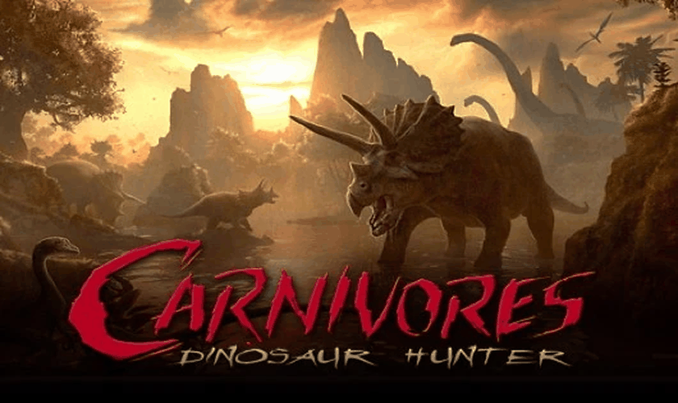

# Carnivores: Dinosaur Hunter — PS Vita port

<p align="center">
  
</p>

so-loader port of the Android version (1.3.1) of *Carnivores: Dinosaur Hunter* (Tatem Games / Action Forms).
It runs the original `libdinHunter.so` + `libfmodex.so` with an emulated Java layer (FalsoJNI).
You need your own copy of the game APK; nothing from the game is distributed here.

> Status: menus and hunting (3D maps) run on real hardware (v1.0.0). v1.1.0 adds the controls &
> camera menu and button navigation, not yet confirmed on hardware. See [`RELEASE.md`](RELEASE.md)
> and `port_progress.md`.

## Install

1. Install `kubridge.skprx` and `libshacccg.suprx` (ShaRKBR33D).
2. Install `carnivoresdinosaurhunter.vpk`.
3. Create `ux0:data/carnivoresdinosaurhunter/` and copy into it:
   - the original APK, named `CarnivoresDinosaurHunter.apk` (`main.apk` or `game.apk` also work)
   - `libdinHunter.so` and `libfmodex.so` from the APK's `lib/armeabi/` folder
4. Launch. The first boot loads for about 30 seconds on a static screen (on Android a splash
   screen covers it). Logs go to `ux0:data/carnivoresdinosaurhunter/logs/`.

Content packs (optional): on Android they are separate apps. Copy their APKs to the same folder:
- `CarnivoresBundleOne.apk` (`com.tatem.dinhunter.bundle.one`, areas 3-4 + sniper rifle) as `bundle1.apk`
- `CarnivoresBundleTwo.apk` (`com.tatem.dinhunter.bundle.two`, area 6 + double-barrel shotgun +
  crossbow) as `bundle2.apk`

A pack is unlocked only when its APK is present; without it, its maps and weapons stay locked.

Only the Android **1.3.1** APK (`com.tatem.dinhunter`) works. The HD version
(`com.tatem.dinhunterhd`, 1.6.5) and its OBB (`main.423.com.tatem.dinhunterhd.obb`) are a different,
OpenGL ES 2 engine with another asset layout (`Common/`, `DinHunter/`) and formats (`.cat`, `.rst`,
`.pkm`, shaders); this loader can't use them, and the 1.3.1 engine never opens an OBB.

## Controls

### Default controls

| Vita | Action |
|---|---|
| Touch screen | Original touch controls |
| Left stick | Move |
| Right stick | Look / aim |
| R | Fire (draws the weapon first if it is holstered) / take photo |
| Cross | Jump |
| Square | Draw / holster weapon |
| Triangle | Next weapon |
| L | Binoculars |
| Circle / D-pad up | Call dinosaurs |
| Select / D-pad down | Map |
| D-pad left | Weapon list (the HUD weapon button) |
| D-pad right | Photo mode zoom in |
| Start | Pause / back |
| **Start + Select** | **PS Vita controls & camera menu** |

Fire works with every "firing method" of the game's options (fire button, alternative fire button
or tap the screen).

### Menus

The game's menus can be used with buttons too: the d-pad or left stick moves a highlight over the
buttons, Cross presses the highlighted one, Left/Right move sliders and Circle (or Start) goes back.
The highlight is fitted to what each item looks like on screen (sprite, text, slider knob), and the
hunt menu's area / dinosaur / weapon cells are included.
Touching the screen hides the highlight; the next d-pad press brings it back.

### PS Vita controls & camera menu

Press **Start + Select** while hunting (the hunt is paused underneath), or **Select** in any of the
game's menus. From there:

- Remap every action: Cross replaces the buttons of the highlighted action, Square adds one more,
  Triangle leaves it unbound. A button can only belong to one action, so it is taken off the
  previous one. Rear touch quadrants count as buttons.
- Camera: right stick speed, invert up/down, invert left/right, swap sticks (left = camera).
- Opacity of the touch HUD buttons.
- Restore defaults.

Circle saves and closes. Bindings go to `ux0:data/carnivoresdinosaurhunter/controls.txt`, the rest to
`config.txt`; both can also be edited by hand:

```ini
VERSION = 2
FIRE = R1
JUMP = CROSS
WEAPON = SQUARE
NEXT_WEAPON = TRIANGLE
WEAPON_MENU = LEFT
BINOCULARS = L1
CALL = CIRCLE, UP
MAP = DOWN, SELECT
ZOOM_IN = RIGHT
ZOOM_OUT = NONE
```

Buttons: `CROSS`, `CIRCLE`, `SQUARE`, `TRIANGLE`, `L1`, `R1`, `UP`, `DOWN`, `LEFT`, `RIGHT`, `SELECT`,
rear touch `L2` (top-left), `R2` (top-right), `L3` (bottom-left), `R3` (bottom-right), and `NONE`.
`BUTTON = ACTION` lines work too. A `controls.txt` from an older version (without `VERSION = 2`) is
replaced by the defaults.

While hunting, the touch HUD buttons (move stick, fire, alternative fire, weapon, binoculars, call,
map, pause and the photo mode buttons) are drawn at 1% opacity, since the physical controls replace
them. They still respond to touch where they normally are. The compass and the menus keep their
normal look.

## Trophies

26 native PS Vita trophies (the game's 25 awards + Platinum), installed on first launch and shown
with the system notification. Needs `NoTrpDrm.suprx` under `*main` in `ur0:tai/config.txt`
(reboot after editing). Without the plugin the game runs normally with trophies off.

The trophy pack ships in the VPK (`sce_sys/trophy/CRDH00001_00/TROPHY.TRP`) and is rebuilt with
`python3 extras/scripts/generate_trophies.py` (needs the extracted APK for the icons). v1.0.0
shipped without it, which made the game hang at boot when NoTrpDrm was installed.

On the first launch with NoTrpDrm the screen stays black for a while as the trophies install, with
no progress indicator. Don't close the game during this step (open issue: it needs a loading
screen).

## Offline cleanup

There is no network on Vita, so every Facebook element ("share hunt / statistics / trophy" and
login / logout) is hidden from the menus, trophy room and score screens, and the Facebook functions
do nothing.

## Options

`ux0:data/carnivoresdinosaurhunter/config.txt` (rewritten on every boot, so new keys show up):

| Key | Default | Meaning |
|---|---|---|
| `look_sensitivity` | `100` | Right stick camera speed in percent (10–400). Frame-rate independent; stacks with the in-game sensitivity slider |
| `invert_look_y` | `0` | Invert the camera's vertical axis |
| `invert_look_x` | `0` | Invert the camera's horizontal axis |
| `swap_sticks` | `0` | 1: left stick looks, right stick moves |
| `msaa` | `0` | Anti-aliasing: 0 off (fastest), 1 2x, 2 4x |
| `engine_log` | `0` | Write the game's own debug messages to the log (slow: several lines per asset while loading) |
| `hud_opacity` | `1` | Opacity of the touch HUD buttons while hunting, in percent (0–100; 100 = original). The compass is not affected |
| `vfp_float` | `1` | Run the game's software floating point on the Vita FPU (big speedup; 0 only to rule it out if something looks wrong) |

## Building

Requires VitaSDK. vitaGL is vendored in `vendor/vitaGL` and built automatically with
`SOFTFP_ABI=1 NO_SPLASHSCREEN=1 NO_DEBUG=1 HAVE_SHADER_CACHE=1`. Build and deploy with
psvita-port-toolkit (`psvita-toolkit build`, `psvita-toolkit deploy --vpk`), or plain CMake:

```sh
mkdir -p build && cd build && cmake .. -DCMAKE_POLICY_VERSION_MINIMUM=3.5 && make
```

The default build type is Release (the log only keeps errors). Configure with
`-DCMAKE_BUILD_TYPE=Debug` (`psvita-toolkit build --preset debug`) to get the full log back: in
Debug the game's own messages are always logged (whatever `engine_log` says), and every libzip
`zip_open()` is logged with its error code.

Two vitaGL gotchas this port depends on:

- The prebuilt `libvitaGL.a` from VitaSDK is not built with `SOFTFP_ABI=1`, and this loader is
  softfp: with it the game runs at 60 FPS on a permanently black screen.
- Do **not** enable `DRAW_SPEEDHACK` (1 or 2): it hands the large terrain vertex arrays straight
  from game memory to the GPU and the console GPU-crashes as soon as a hunt starts.

And one engine gotcha: the game's built-in libzip was compiled for Android and reads a bionic
`FILE` field to check `ferror()`, but here every `FILE*` comes from SceLibc. `source/patch.c`
patches those five checks. Without that patch the APK stops opening once a saved game exists
(the engine never closes its save file), which gives a black screen, and the content packs never
open.

## ☕ Support My Work

This project is **free** and will stay free. If you enjoy it, a tip from **$1** helps me keep porting games to the PS Vita:

<p align="center">
  <a href="https://ko-fi.com/metalsyntax"></a>
</p>

- **Ko-fi:** [ko-fi.com/metalsyntax](https://ko-fi.com/metalsyntax)
- **PayPal:** [paypal.me/MetalSyntax](https://paypal.me/MetalSyntax)
- **Bitcoin (BTC):** `133HdCsaWxdjTfmwpgGVykByhNBV338uRc`

**Ko-fi supporters get:**
- **Early access** to new ports before their public release (test builds of upcoming projects).
- **Data preparation scripts and step-by-step guides** to set up your own game files for each new port.
- A say in which games I port next.

> Game files are never distributed. You always need your own legally obtained copy of the game.

---

## Credits

Based on [soloader-boilerplate](https://github.com/v-atamanenko/soloader-boilerplate) (TheFloW, Rinnegatamante,
Volodymyr Atamanenko) and FalsoJNI. vitaGL by Rinnegatamante, kubridge by bythos.
Input mapping, soft-float VFP hooks and vitaGL setup shared with the Carnivores: Ice Age Vita port
(same Tatem engine).

## License

The loader is MIT-licensed (see [LICENSE](LICENSE)). The game, its assets and its `.so` files remain
the property of Tatem Games.
