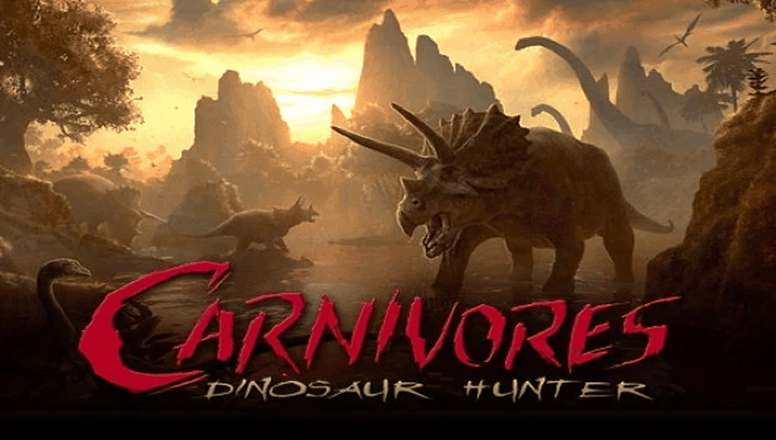

<h1 align="center">
  <br>
  Carnivores: Dinosaur Hunter · PS Vita Port
</h1>

<p align="center">
  <b>Native port of Carnivores: Dinosaur Hunter (Tatem Games / Action Forms) for PlayStation Vita and PlayStation TV.</b>
</p>

<p align="center">
  
  
  
  
  
  
</p>

<p align="center">
  <a href="#-description">Description</a> •
  <a href="#-features">Features</a> •
  <a href="#-controls">Controls</a> •
  <a href="#-installation">Installation</a> •
  <a href="#-known-issues">Known Issues</a> •
  <a href="#-building-from-source">Build</a> •
  <a href="#-credits">Credits</a>
</p>

---

## 📖 Description

**Carnivores: Dinosaur Hunter** is Tatem Games' dinosaur hunting game, originally released for Android as
`CarnivoresDinosaurHunter.apk` (Android version **1.3.1**, package `com.tatem.dinhunter`, `armeabi`).

This is a so-loader port. It runs the original `libdinHunter.so` and `libfmodex.so` with an emulated Java layer
(FalsoJNI), with [vitaGL](https://github.com/Rinnegatamante/vitaGL) providing the OpenGL ES 1.1 rendering backend.
The game's assets are read in place from the APK (and from the optional content-pack APKs), and nothing from the
game is distributed here.

---

## 🎮 Status & Playability

**Status: Playable (beta) (v1.2.0)** — menus and hunting on the 3D maps run on real hardware. Content packs, FMOD
audio and saved games load on the console; frame rate while hunting is the main limitation.

- [x] **Loader**: boot, full asset loading straight from the APK, menus at 60 FPS. *Verified on console (per `RELEASE.md`).*
- [x] **Hunting**: map loading and hunting in the 3D maps. *Verified on console (per `RELEASE.md`).*
- [x] **Audio**: FMOD music and sound effects. *Verified on console (per `RELEASE.md`).*
- [x] **Content packs**: Pack 1 and Pack 2, unlocked only when their APK is present. *Verified on console (per `RELEASE.md`).*
- [x] **Saves**: saved games load on the next boot. *Verified on console (per `RELEASE.md`).*
- [ ] **Controls & camera menu (v1.1.0)**: Start + Select menu with remapping, camera options and touch HUD opacity. Not yet confirmed on hardware.
- [ ] **Native trophies**: installed on first launch, but unlocks not yet checked one by one on hardware.

### ✨ What works

- Boot, full asset loading straight from the APK, menus at 60 FPS.
- Map loading and hunting in the 3D maps; a tester reports 30–60 FPS while hunting (per `RELEASE.md`).
- FMOD music and sound effects.
- Content packs (**Pack 1**: areas 3–4 + sniper rifle; **Pack 2**: area 6 + double-barrel shotgun + crossbow),
  unlocked only when their APK is present.
- Saved games load on the next boot.
- Touch screen with the original controls, left/right stick movement and camera.
- Button navigation in the game's menus (see [Controls](#-controls)).
- Facebook elements hidden: there is no network on the Vita, so share / login buttons are removed from the menus,
  trophy room and score screens, and the Facebook functions do nothing.

### 🔧 Port fixes

Five bugs stood between the APK and a playable game, each found on real hardware (v1.0.0):

- **The game couldn't read its own APK.** With SceLibc I/O, `fopen`/`fread` went to SceLibc while
  `fseeko`/`ftello`/`clearerr` still went to newlib with a SceLibc `FILE*`, so libzip computed a garbage archive
  size and every asset came back "not found". Those three now go through the SceLibc bridge too.
- **Permanent black screen at 60 FPS.** The prebuilt `libvitaGL.a` in VitaSDK is not built with `SOFTFP_ABI=1`, but
  the loader is softfp, so GXM's viewport received its floats in the wrong registers and every draw, even plain
  clears, landed off screen. vitaGL is now vendored and built with the softfp ABI.
- **GPU crash as soon as a hunt started.** vitaGL's `DRAW_SPEEDHACK` hands vertex arrays above a size threshold
  straight from game memory to the GPU. Menu sprites are small and got copied, but the terrain is not, and the GPU
  faulted reading memory it has no mapping for. The speedhack is off.
- **Black screen on the second launch.** The engine opens its save file and never closes it, so once a save exists
  the APK gets a different `FILE*`. The libzip inside the game was built for Android and checks `ferror()` by
  reading a bionic `FILE` field directly; on a SceLibc `FILE` that field is meaningless. The five inlined checks are
  patched out (`source/patch.c`). This is also what lets the content-pack APKs open next to the main one.
- **Crash in FMOD when a sound file is missing.** `Sounds_AddSound()` doesn't check whether the file was found, and
  passed leftover stack data to FMOD as the sound buffer. A missing file now gives FMOD an empty buffer, which it
  rejects cleanly.

Performance work:

- The engine is `armeabi` (ARMv5TE), so all of its float/double math goes through libgcc's software emulation.
  32 of those helpers are redirected to the Vita's VFP; every hook was checked against the real `.so` with objdump.
- The engine's own logging is dropped before formatting (it wrote several lines per asset while loading and forced
  memory card flushes).
- MSAA off by default, Release build, vitaGL with error checking off and FFP shader cache on.

### 📜 Changelog

**v1.2.0 "Trophies"**
- **26 native PS Vita trophies**: the game's 25 awards (First Blood, T-Rex Hunter, William Tell, Guru...) plus a
  Platinum. They install on first launch and unlock with the system notification. Requires `NoTrpDrm.suprx`
  under `*main` in `ur0:tai/config.txt` (reboot after editing).
- **Fixed: with NoTrpDrm installed the game didn't boot.** v1.0.0 and v1.1.0 shipped without a trophy pack; with the
  plugin, the trophy setup step had nothing to install and never finished. The pack now ships in the VPK, and trophy
  setup is skipped (the game boots without trophies) if the pack is missing or setup takes longer than 30 seconds.
- Without NoTrpDrm the game runs as before, with trophies off.
- **Menus**: the button-navigation highlight is now four translucent white corner marks instead of a filled yellow
  box that covered the item.
- Install over an earlier version is fine: saves and packs are kept. A `controls.txt` from v1.0.0 is replaced by the
  new defaults on first boot.

**v1.1.0**
- Adds the controls & camera menu and button navigation. Not yet confirmed on hardware (see the Status checklist).

**v1.0.0**
- First playable release: boot, menus, hunting on the 3D maps, content packs and FMOD (see *Port fixes*).

---

## ✨ Features

| Feature | Status | Notes |
| :--- | :---: | :--- |
| Boots to gameplay | ✅ | Boot and full asset loading from the APK |
| Graphics / renderer | ✅ | vitaGL (softfp, vendored), menus at 60 FPS |
| Audio & music | ✅ | FMOD music and sound effects; some dinosaur sounds may be missing (see Known Issues) |
| Video / cutscenes | 🧪 | Not tested yet |
| Physical buttons | ✅ | Default layout and remapping, see [Controls](#-controls) |
| Analog sticks / camera | ✅ | Left stick moves, right stick looks; camera speed and inversion in the menu |
| Touch screen | ✅ | Original touch controls; HUD buttons stay touch-responsive at 1 % opacity |
| Button remapping / port menu | 🧪 | Start + Select: remap every action, camera options, touch HUD opacity, restore defaults (v1.1.0; not yet confirmed on hardware) |
| Save data | ✅ | Saved games load on the next boot |
| Native trophies | 🧪 | 26 trophies (25 + Platinum) installed; unlocks not checked one by one on hardware |
| Languages | 🧪 | ❔ <!-- TODO: not documented in the repo --> |
| Performance | 🟡 | 20–30 FPS reported while hunting (Known Issues); a tester reports 30–60 FPS (per `RELEASE.md`) |
| Online / IAP / ads | ➖ | No network on Vita; Facebook elements hidden |
| PS TV | 🧪 | Listed as supported in `RELEASE.md`; not separately confirmed |

Legend: `✅ Working (verified on console) · 🧪 Implemented, not yet verified on console · 🟡 Partial · ❌ Not working · ➖ Not applicable · ❔ Not documented yet`

---

## 🎯 Controls

### Default controls

| Vita | Action |
| :--- | :--- |
| Touch screen | Original touch controls |
| Left stick | Move |
| Right stick | Look / aim (frame-rate independent) |
| R | Fire (draws the weapon first if it is holstered) / take photo |
| Cross | Jump |
| Square | Draw / holster weapon |
| Triangle | Next weapon |
| L | Binoculars |
| Circle / D-pad up | Call dinosaurs |
| Select / D-pad down | Map |
| D-pad left | Weapon list (the HUD weapon button) |
| D-pad right | Photo mode zoom in |
| Start | Pause / back |
| **Start + Select** | **PS Vita controls & camera menu** |

Fire works with every "firing method" of the game's options (fire button, alternative fire button or tap the screen).

### Menus

The game's menus can be used with buttons too: the d-pad or left stick moves a highlight over the buttons, Cross
presses the highlighted one, Left/Right move sliders and Circle (or Start) goes back. The highlight is four
translucent white corner marks fitted to what each item looks like on screen (sprite, text, slider knob), and the
hunt menu's area / dinosaur / weapon cells are included. Touching the screen hides the highlight; the next d-pad
press brings it back.

### PS Vita controls & camera menu

Press **Start + Select** while hunting (the hunt is paused underneath), or **Select** in any of the game's menus.
From there:

- Remap every action: Cross replaces the buttons of the highlighted action, Square adds one more, Triangle leaves
  it unbound. A button can only belong to one action, so it is taken off the previous one. Rear touch quadrants
  count as buttons.
- Camera: right stick speed, invert up/down, invert left/right, swap sticks (left = camera).
- Opacity of the touch HUD buttons.
- Restore defaults.

Circle saves and closes. Bindings go to `ux0:data/carnivoresdinosaurhunter/controls.txt`, the rest to `config.txt`;
both can also be edited by hand:

```ini
VERSION = 2
FIRE = R1
JUMP = CROSS
WEAPON = SQUARE
NEXT_WEAPON = TRIANGLE
WEAPON_MENU = LEFT
BINOCULARS = L1
CALL = CIRCLE, UP
MAP = DOWN, SELECT
ZOOM_IN = RIGHT
ZOOM_OUT = NONE
```

Buttons: `CROSS`, `CIRCLE`, `SQUARE`, `TRIANGLE`, `L1`, `R1`, `UP`, `DOWN`, `LEFT`, `RIGHT`, `SELECT`, rear touch `L2`
(top-left), `R2` (top-right), `L3` (bottom-left), `R3` (bottom-right), and `NONE`. `BUTTON = ACTION` lines work too.
A `controls.txt` from an older version (without `VERSION = 2`) is replaced by the defaults.

While hunting, the touch HUD buttons (move stick, fire, alternative fire, weapon, binoculars, call, map, pause and the
photo mode buttons) are drawn at 1% opacity, since the physical controls replace them. They still respond to touch
where they normally are. The compass and the menus keep their normal look.

---

## 🏆 Trophies

26 native PS Vita trophies (the game's 25 awards + Platinum), installed on first launch and shown with the system
notification. Needs `NoTrpDrm.suprx` under `*main` in `ur0:tai/config.txt` (reboot after editing). Without the plugin
the game runs normally with trophies off.

The trophy pack ships in the VPK (`sce_sys/trophy/CRDH00001_00/TROPHY.TRP`) and is rebuilt with
`python3 extras/scripts/generate_trophies.py` (needs the extracted APK for the icons). v1.0.0 shipped without it,
which made the game hang at boot when NoTrpDrm was installed.

On the first launch with NoTrpDrm the screen stays black for a while as the trophies install, with no progress
indicator. Don't close the game during this step.

---

## 📋 Prerequisites

1. PS Vita / PS TV on **HENkaku / Enso** (3.60–3.74 with a kernel plugin loader).
2. [**kubridge**](https://github.com/TheOfficialFloW/kubridge/releases) (`kubridge.skprx`) in `*KERNEL` of your taiHEN config.
3. [**libshacccg.suprx**](https://github.com/Rinnegatamante/ShaRKBR33D/releases/latest) in `ur0:data/` (use ShaRKBR33D).
4. A legally obtained copy of **Carnivores: Dinosaur Hunter 1.3.1** for Android (`com.tatem.dinhunter`, `armeabi`).
5. *(Optional, for trophies)* [**NoTrpDrm**](https://github.com/Rinnegatamante/NoTrpDrm) (`NoTrpDrm.suprx`) under `*main` in `ur0:tai/config.txt` (reboot after editing).
6. *(Optional, for the content packs)* `CarnivoresBundleOne.apk` and `CarnivoresBundleTwo.apk` from Android.

> Only the Android **1.3.1** APK (`com.tatem.dinhunter`) works. The HD version (`com.tatem.dinhunterhd`, 1.6.5) and its
> OBB (`main.423.com.tatem.dinhunterhd.obb`) are a different, OpenGL ES 2 engine with another asset layout
> (`Common/`, `DinHunter/`) and formats (`.cat`, `.rst`, `.pkm`, shaders); this loader can't use them, and the 1.3.1
> engine never opens an OBB.

## 📦 Installation


1. Install `carnivoresdinosaurhunter.vpk` with **VitaShell**. Install the full VPK, not just `eboot.bin`: the trophy
   pack lives in `sce_sys/`.
2. Create `ux0:data/carnivoresdinosaurhunter/` and copy into it:
   - the original APK, named `CarnivoresDinosaurHunter.apk` (`main.apk` or `game.apk` also work)
   - `libdinHunter.so` and `libfmodex.so` from the APK's `lib/armeabi/` folder
3. Launch the game. The first boot loads for about 30 seconds on a static screen (on Android a splash screen covers
   it). Logs go to `ux0:data/carnivoresdinosaurhunter/logs/`.

Content packs (optional): on Android they are separate apps. Copy their APKs to the same folder:

- `CarnivoresBundleOne.apk` (`com.tatem.dinhunter.bundle.one`, areas 3-4 + sniper rifle) as `bundle1.apk`
- `CarnivoresBundleTwo.apk` (`com.tatem.dinhunter.bundle.two`, area 6 + double-barrel shotgun + crossbow) as `bundle2.apk`

A pack is unlocked only when its APK is present; without it, its maps and weapons stay locked.

### Final File Structure in `ux0:data/carnivoresdinosaurhunter/`

```text
ux0:data/carnivoresdinosaurhunter/
├── CarnivoresDinosaurHunter.apk  <- the original APK, renamed
├── libdinHunter.so               <- lib/armeabi/ in the APK
├── libfmodex.so                  <- lib/armeabi/ in the APK
├── bundle1.apk                   <- (optional) CarnivoresBundleOne.apk
├── bundle2.apk                   <- (optional) CarnivoresBundleTwo.apk
├── config.txt                    <- settings (rewritten on every boot)
├── controls.txt                  <- button bindings (Start + Select menu)
└── logs/                         <- per-run logs
```

### ⚙️ Options

`ux0:data/carnivoresdinosaurhunter/config.txt` is rewritten on every boot, so new keys show up automatically. Most
options are in the in-game menu (Start + Select). One `key value` per line:

| Key | Default | Meaning |
| :--- | :---: | :--- |
| `look_sensitivity` | `100` | Right stick camera speed in percent (10–400). Frame-rate independent; stacks with the in-game sensitivity slider |
| `invert_look_y` | `0` | Invert the camera's vertical axis |
| `invert_look_x` | `0` | Invert the camera's horizontal axis |
| `swap_sticks` | `0` | 1: left stick looks, right stick moves |
| `msaa` | `0` | Anti-aliasing: 0 off (fastest), 1 = 2x, 2 = 4x |
| `engine_log` | `0` | Write the game's own debug messages to the log (slow: several lines per asset while loading) |
| `hud_opacity` | `1` | Opacity of the touch HUD buttons while hunting, in percent (0–100; 100 = original). The compass is not affected |
| `vfp_float` | `1` | Run the game's software floating point on the Vita FPU (big speedup; 0 only to rule it out if something looks wrong) |

## 🐛 Known Issues

- **Black screen while trophies install (first launch with NoTrpDrm).** The screen stays black for a while with no
  progress indicator before the game starts. Don't close the game or turn the console off during this step. A
  loading screen for it is planned.
- **Frame rate:** 20–30 FPS has been reported while hunting, dropping when dinosaurs are on screen. Not fixed yet; it
  needs profiling on hardware first.
- Trophy unlocks and the Platinum have not yet been checked one by one on hardware; please report any award that
  shows in game but doesn't pop the trophy.
- The first load is a ~30 s static screen with no progress indicator.
- Many `FMOD error 'An invalid parameter...'` messages while loading dinosaur sounds. They don't crash, but some
  sounds may be missing. The FMOD missing-sound fix has not been through a very long session yet.
- Exiting is done from the PS button (the Android "Exit?" dialog from the main menu is skipped).
- Report anything else with the newest log from `ux0:data/carnivoresdinosaurhunter/logs/` (and the `.psp2dmp` from
  `ux0:data/` for a crash).

---

## 🔨 Building from Source

Requires VitaSDK. vitaGL is vendored in `vendor/vitaGL` and built automatically with
`SOFTFP_ABI=1 NO_SPLASHSCREEN=1 NO_DEBUG=1 HAVE_SHADER_CACHE=1`. Build and deploy with psvita-port-toolkit
(`psvita-toolkit build`, `psvita-toolkit deploy --vpk`), or plain CMake:

```sh
mkdir -p build && cd build && cmake .. -DCMAKE_POLICY_VERSION_MINIMUM=3.5 && make
```

The default build type is Release (the log only keeps errors). Configure with `-DCMAKE_BUILD_TYPE=Debug`
(`psvita-toolkit build --preset debug`) to get the full log back: in Debug the game's own messages are always logged
(whatever `engine_log` says), and every libzip `zip_open()` is logged with its error code.

Two vitaGL gotchas this port depends on:

- The prebuilt `libvitaGL.a` from VitaSDK is not built with `SOFTFP_ABI=1`, and this loader is softfp: with it the game
  runs at 60 FPS on a permanently black screen.
- Do **not** enable `DRAW_SPEEDHACK` (1 or 2): it hands the large terrain vertex arrays straight from game memory to
  the GPU and the console GPU-crashes as soon as a hunt starts.

## 📁 Project Structure

- `source/`: loader core, including `patch.c` (libzip `FILE` checks and other `.so` patches) and `input.c`.
- `vendor/vitaGL/`: vitaGL built from source (softfp ABI).
- `extras/`: LiveArea assets and `scripts/generate_trophies.py`.
- `ux0_data/`: staging tree for the data files (not committed).
- `PORTING_PLAN.md` / `port_progress.md`: porting notes and bug-by-bug progress log.
- `RELEASE.md`: release checklist and release text.

---

## 📜 Disclaimer

**Carnivores: Dinosaur Hunter** is a trademark of **Tatem Games**. The work presented in this repository is
unofficial and is not produced, endorsed, or sanctioned by Tatem Games or any affiliated entities.

This software does not contain the original game code, binaries, or assets. The authors do not promote or condone
piracy in any way. To play, you must provide your own legally obtained copy of the game (`.apk`).

---

## ☕ Support My Work

This project is **free** and will stay free. If you enjoy it, a tip from **$1** helps me keep porting games to the PS Vita:

<p align="center">
  <a href="https://ko-fi.com/metalsyntax"></a>
</p>

- **Ko-fi:** [ko-fi.com/metalsyntax](https://ko-fi.com/metalsyntax)
- **PayPal:** [paypal.me/MetalSyntax](https://paypal.me/MetalSyntax)
- **Bitcoin (BTC):** `133HdCsaWxdjTfmwpgGVykByhNBV338uRc`

**Ko-fi supporters get:**
- **Early access** to new ports before their public release (test builds of upcoming projects).
- **Data preparation scripts and step-by-step guides** to set up your own game files for each new port.
- A say in which games I port next.

> Game files are never distributed. You always need your own legally obtained copy of the game.

---

## 👥 Credits

- **Tatem Games / Action Forms**: original developers of Carnivores: Dinosaur Hunter.
- **MetalSyntax**: this port.
- Based on [soloader-boilerplate](https://github.com/v-atamanenko/soloader-boilerplate) (TheFloW, Rinnegatamante, Volodymyr Atamanenko) and FalsoJNI.
- **Rinnegatamante**: [vitaGL](https://github.com/Rinnegatamante/vitaGL) and [NoTrpDrm](https://github.com/Rinnegatamante/NoTrpDrm).
- **bythos**: kubridge.
- Input mapping, soft-float VFP hooks and vitaGL setup shared with the Carnivores: Ice Age Vita port (same Tatem engine).

---

## 📄 License

The loader is MIT-licensed — see the [LICENSE](LICENSE) file. The game, its assets and its `.so` files remain the
property of Tatem Games.
